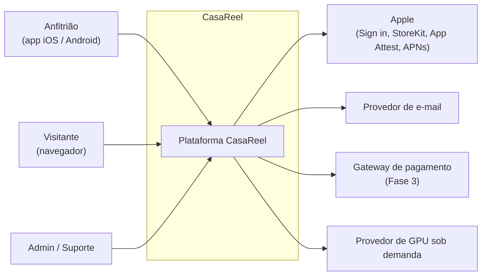
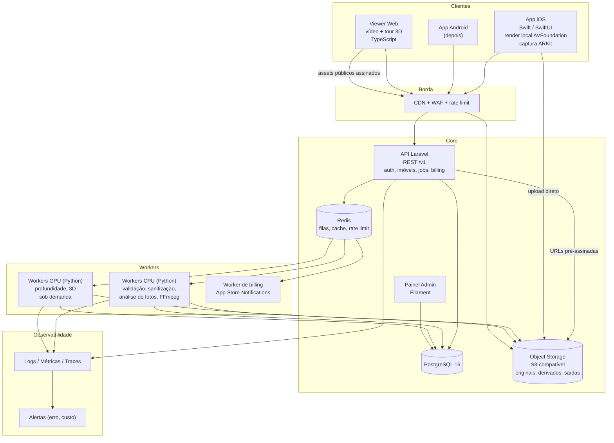
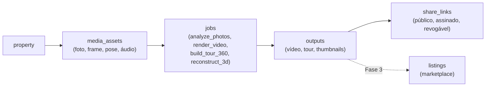

# Arquitetura Geral

## 1. Visão de contexto (C4 — nível 1)

## 2. Contêineres (C4 — nível 2)

## 3. Modelo conceitual: `property → media_assets → jobs → outputs`

Todo recurso do produto é um **job** sobre **ativos de mídia** de um **imóvel** que produz **outputs**. Isso permite incluir novas fases sem reescrever o core.

## 4. Componentes por fase

| Componente | Fase 1 | Fase 2 | Fase 3 |
|---|---|---|---|
| App iOS | Seleção, templates, render local, share | Captura ARKit, status do 3D | Publicação, busca, chat |
| API Laravel | Auth, imóveis, upload, jobs, billing | Tours, captura, viewer tokens | Listings, busca, reservas, pagamentos |
| Workers CPU | Validar, sanitizar, analisar, render opcional | Pré-checagem de qualidade, 360 | Moderação de imagens |
| Workers GPU | (opcional) profundidade/parallax | Reconstrução 3D | Moderação por visão |
| Viewer Web | Página do vídeo | Viewer 3D | Página do anúncio |
| Busca | — | — | OpenSearch/pgvector |

## 5. Decisões de tecnologia

| Camada | Escolha | Justificativa |
|---|---|---|
| App iOS | Swift 6, SwiftUI, SwiftData/Keychain, SPM modular | Nativo, acesso a AVFoundation/ARKit/StoreKit 2/App Attest |
| Render de vídeo | AVFoundation + Core Image / Metal no aparelho | Custo zero de servidor na Fase 1 |
| Captura 3D | ARKit (poses + intrínsecos) + frames | Funciona sem LiDAR; poses reduzem erro de reconstrução |
| API | Laravel 13, PHP 8.4, Octane opcional | Domínio do time, ecossistema maduro (Sanctum, Horizon, Pest) |
| Banco | PostgreSQL 16 (+ PostGIS na Fase 3, pgvector opcional) | Integridade, JSONB, particionamento, busca geográfica |
| Fila/cache | Redis 7 + Laravel Horizon | Fila confiável, rate limit, cache |
| Workers | Python 3.12 (FFmpeg, PyTorch, OpenCV) | Ecossistema de visão/ML |
| 3D | Gaussian Splatting (gsplat/nerfstudio `splatfacto`) com poses do ARKit; COLMAP/GLOMAP como alternativa | Qualidade/tempo; ver doc 04 |
| Viewer | Three.js + viewer de splats (formato `.splat`/`.ply` comprimido) | Roda no navegador mobile |
| Storage | S3-compatível (R2/S3/MinIO) + CDN | URLs assinadas, ciclo de vida |
| Infra | Docker; Compose em dev; Kubernetes ou ECS gerenciado em prod | Escala de workers; GPU por job |
| IaC | Terraform | Reprodutível |
| CI/CD | GitHub Actions (backend), Xcode Cloud ou fastlane (iOS) | Mac com 8 GB: builds pesados na nuvem |

## 6. Estratégia de render da Fase 1

| Modo | Onde | Quando usar | Custo |
|---|---|---|---|
| **Local** (padrão) | iPhone via AVFoundation | Templates determinísticos (pan/zoom, transições, música) | ~0 |
| **Servidor CPU** | FFmpeg em worker | Aparelho fraco, lote, qualidade extra | baixo |
| **Servidor GPU** | Profundidade/parallax | Template premium "parallax 2.5D" | médio |

O contrato do template (JSON versionado) é o mesmo no app e no worker, para que o resultado seja equivalente. Ver `07-app-ios` e `04-ia`.

## 7. Comunicação e contratos

- API REST versionada (`/v1`), JSON, OpenAPI 3.1 em `06-api/openapi.yaml`
- Jobs: idempotentes, com `idempotency_key`, `attempts`, `max_attempts`, backoff exponencial, DLQ
- Eventos de domínio: `photo.uploaded`, `job.completed`, `job.failed`, `subscription.updated`
- Notificação de término: APNs silencioso + polling com ETag como fallback
- Compatibilidade: campos novos são opcionais; remoção só em `/v2`

## 8. Requisitos de segurança na arquitetura (resumo)

- Uploads **nunca** passam pelo PHP: URL pré-assinada com tipo, tamanho e checksum exigidos; escaneamento e sanitização antes de qualquer processamento
- Workers rodam sem acesso à internet de saída por padrão (egress mínimo), com credenciais de escopo estreito
- Buckets privados; entrega por URL assinada com expiração curta ou CDN com token
- Segredos em gerenciador de segredos; nada no repositório
- Detalhes em `05-seguranca/`

## 9. Escalabilidade e resiliência

- API stateless atrás de load balancer; Redis e Postgres gerenciados com réplica
- Filas separadas por prioridade e tipo (`default`, `media-cpu`, `gpu`, `billing`)
- Workers GPU com *scale-to-zero*; limite de concorrência e teto de gasto diário
- Circuit breaker para provedores externos; timeouts em todas as chamadas
- Backups e testes de restauração periódicos (ver `03-dados/guia-dba.md`)
