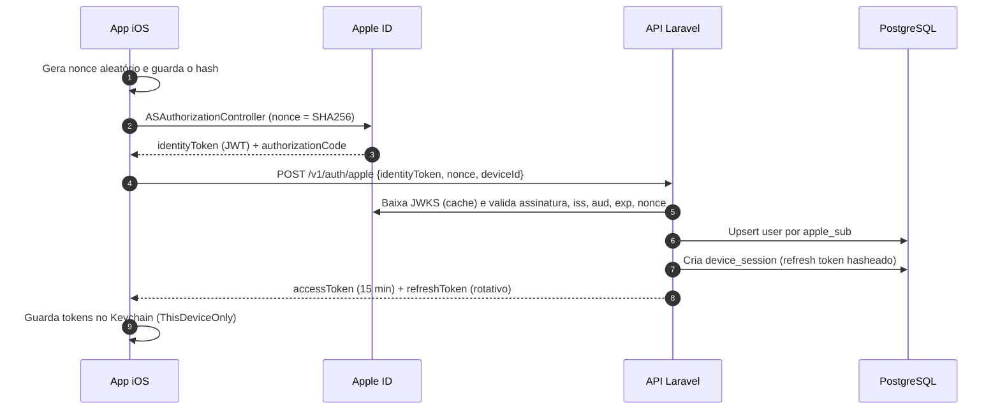
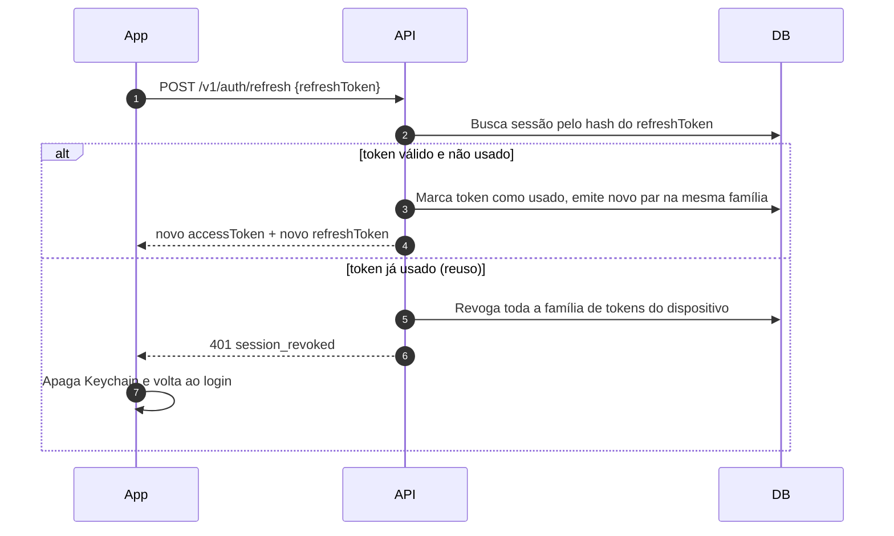
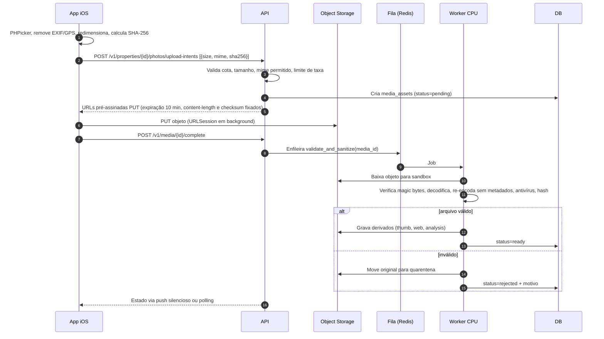
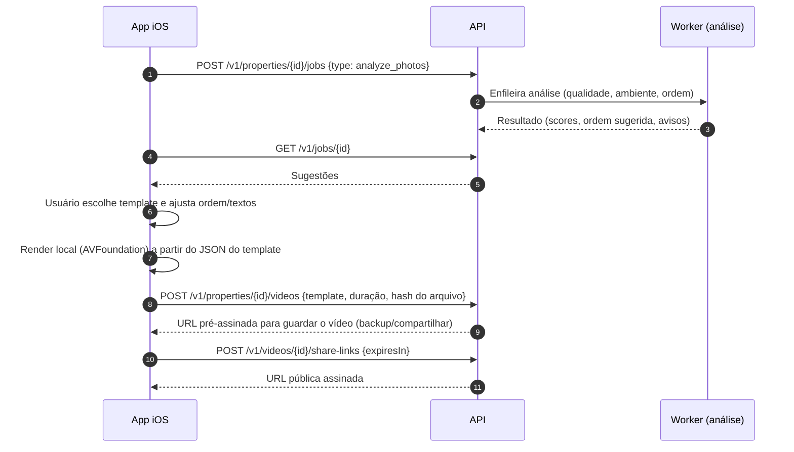
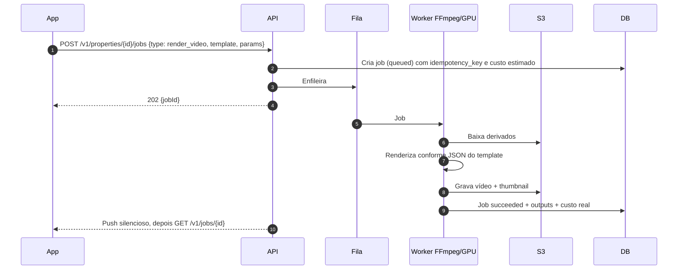
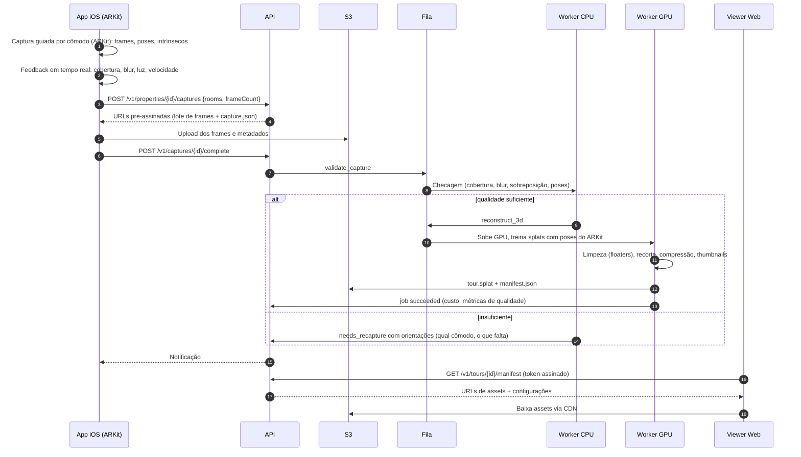
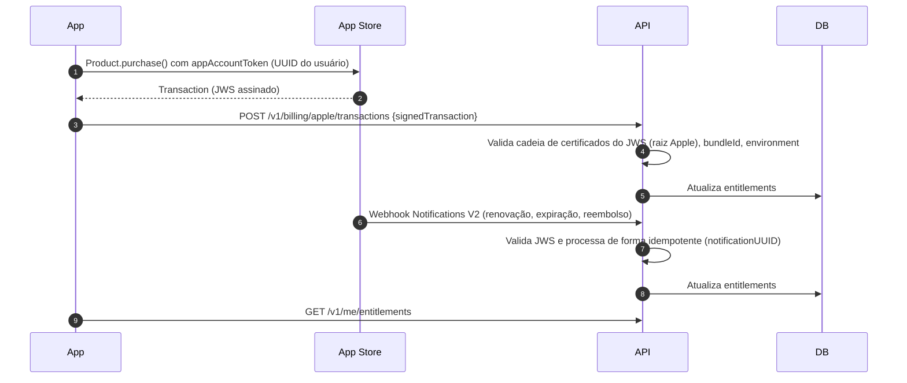
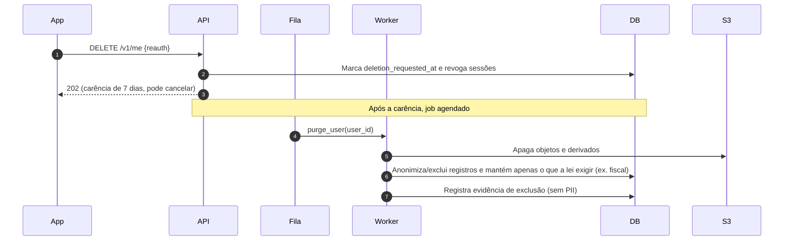

# Fluxos principais (diagramas de sequência)

## 1. Login com Sign in with Apple + token do app

## 2. Renovação de token com rotação e detecção de reuso

## 3. Upload seguro de fotos

## 4. Geração de vídeo — render local (padrão da Fase 1)

## 5. Geração de vídeo — render no servidor (premium)

## 6. Tour 3D (Fase 2) — captura sem LiDAR

## 7. Assinatura (StoreKit 2 + validação no servidor)

## 8. Exclusão de conta (LGPD)

