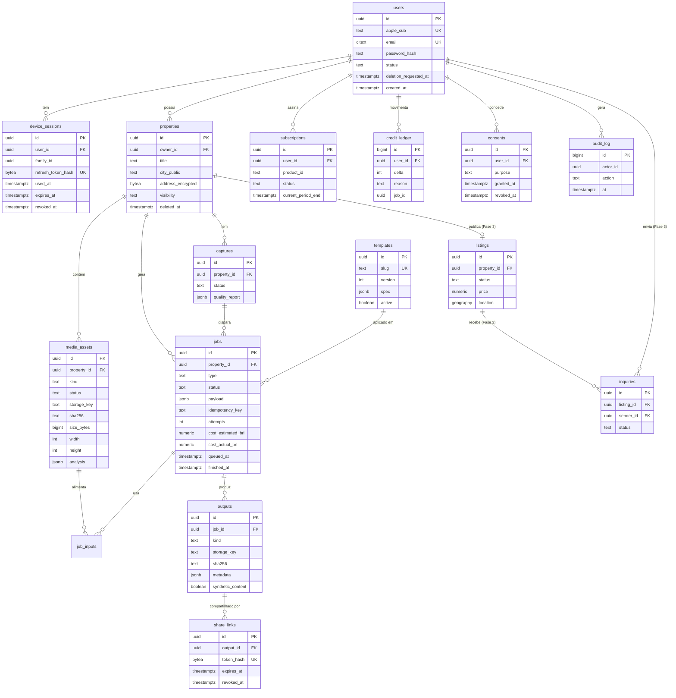
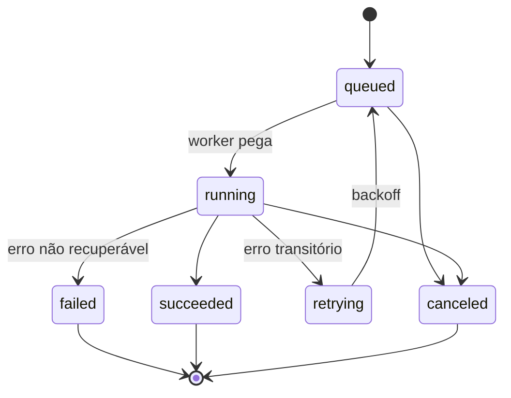
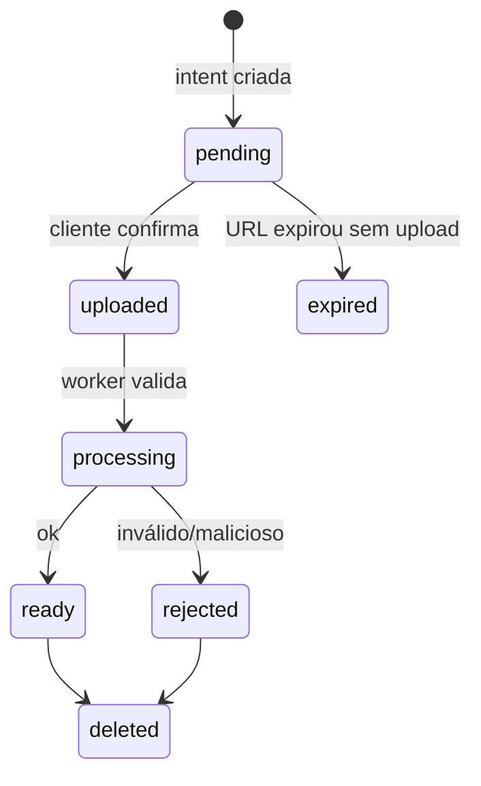

# Modelo de Dados (visão DBA)

SGBD: **PostgreSQL 16**. DDL completo em [`schema.sql`](schema.sql). Guia operacional em [`guia-dba.md`](guia-dba.md).

## 1. Diagrama ER (Fases 1 e 2 + extensão da Fase 3)

## 2. Decisões de modelagem

| Tema | Decisão | Motivo |
|---|---|---|
| Chaves | `uuid` v7 (ordenável no tempo) gerado pela aplicação | Sem enumeração, bom índice B-tree, sem expor contagem |
| E-mail | `citext` com índice único parcial (`WHERE deleted_at IS NULL`) | Unicidade sem diferenciar maiúsculas |
| Endereço do imóvel | Criptografado em nível de aplicação (`bytea`), com `city_public` separada | Minimiza exposição mesmo em dump do banco |
| Tokens | Apenas **hash** (SHA-256) de refresh token e de share token | Vazamento de banco não revela tokens |
| Jobs | Tabela única com `type` + `payload` JSONB validado por JSON Schema na aplicação | Cobre vídeo, 3D e futuros tipos |
| Idempotência | `UNIQUE (owner_id, idempotency_key)` em `jobs` | Evita cobrança dupla em retry |
| Status | `CHECK` com conjunto fechado + máquina de estados na aplicação | Evita estados inválidos |
| Créditos | **Ledger** imutável (`credit_ledger`) com saldo derivado | Auditoria e anti-fraude |
| Exclusão | Soft delete + purge agendado (`deletion_requested_at`) | Carência de 7 dias e LGPD |
| Mídia | Banco guarda só metadados e `storage_key`; binário no object storage | Banco leve |
| Fase 3 | `listings`/`inquiries` aditivos; PostGIS apenas quando necessário | Migração sem quebra |
| Conteúdo sintético | `outputs.synthetic_content` obrigatório | Rotulagem (ADR-008) |

## 3. Máquina de estados dos jobs

## 4. Máquina de estados de `media_assets`

## 5. Dados que NÃO ficam no banco

- Binários (fotos, vídeos, splats) → object storage
- Segredos e chaves → gerenciador de segredos/KMS
- Logs de aplicação → plataforma de logs (sem PII)
