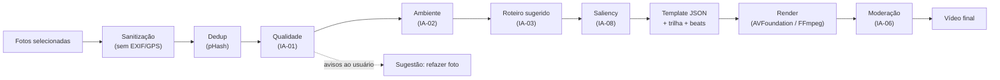
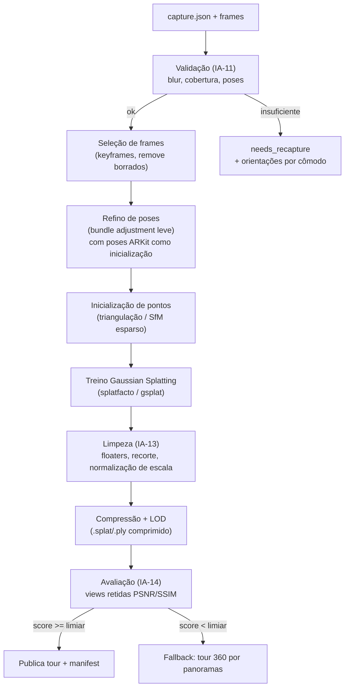

# IA e Ciência de Dados

Objetivo: usar IA para **acelerar** a produção de vídeo e 3D e melhorar a qualidade, **sem inventar o imóvel**.

## 1. Princípios

1. **Fidelidade primeiro (ADR-008):** nada de gerar cômodos, móveis, vistas ou acabamentos inexistentes. Efeitos são geométricos/fotográficos (movimento de câmera, profundidade, correção de cor).
2. **Determinismo por padrão:** a Fase 1 funciona sem modelos pesados. IA entra como assistente (ordem, qualidade, sugestões) e como acelerador opcional (parallax).
3. **Medir antes de automatizar:** cada modelo tem métrica, conjunto de avaliação e limiar de aceitação.
4. **Custo e latência como métricas:** custo por job e tempo por job fazem parte da avaliação.
5. **Privacidade:** treinar com dados de usuários só com consentimento explícito (`ai_improvement`), com opção de revogar.

## 2. Mapa de capacidades

| # | Capacidade | Fase | Onde roda | Técnica | Obrigatória? |
|---|---|---|---|---|---|
| IA-01 | Qualidade da foto (blur, exposição, ruído, horizonte inclinado) | 1 | Aparelho (Core ML) + worker | Métricas clássicas (variância do Laplaciano, histograma) + modelo leve de qualidade (ex.: MobileNet/NIMA) | Não, sugere |
| IA-02 | Classificação do ambiente (sala, quarto, cozinha, banheiro, fachada, varanda, piscina…) | 1 | Aparelho (Core ML) | Classificador leve com fine-tuning em dataset de interiores | Não |
| IA-03 | Ordem sugerida do roteiro (fachada → sala → cozinha → quartos → banheiros → área externa) | 1 | Aparelho/worker | Regras + embedding de similaridade | Não |
| IA-04 | Detecção de duplicatas/quase-duplicatas | 1 | Worker | Hash perceptual (pHash) + embedding | Sim (dedup) |
| IA-05 | Detecção/borrão de rostos, placas, documentos | 1 | Aparelho (Vision) + worker | `VNDetectFaceRectangles` + detector de texto/placa | Opcional (privacidade) |
| IA-06 | Moderação de conteúdo (nudez, violência, spam) | 1 | Worker | Modelo de classificação de segurança + regras | Sim (antes de link público) |
| IA-07 | Correção automática leve (balanço de branco, exposição, perspectiva) | 1 | Aparelho | Core Image / filtros determinísticos | Opcional |
| IA-08 | Enquadramento inteligente (pontos de interesse para o pan/zoom) | 1 | Aparelho | Saliency (`VNGenerateAttentionBasedSaliencyImageRequest`) | Sim (melhora template) |
| IA-09 | Sincronia de cortes com batida da música | 1 | Aparelho/worker | Detecção de beats (librosa/AudioKit) | Opcional |
| IA-10 | Parallax 2.5D | 1–2 | Worker GPU | Estimativa de profundidade monocular (Depth Anything V2 ou similar), camadas + inpainting mínimo de bordas | Premium |
| IA-11 | Validação da captura 3D | 2 | Aparelho + worker | Cobertura angular, blur por frame, sobreposição, consistência de poses | Sim |
| IA-12 | Reconstrução 3D | 2 | Worker GPU | Gaussian Splatting inicializado com poses ARKit | Sim (Fase 2) |
| IA-13 | Limpeza do 3D (floaters, recorte, compressão) | 2 | Worker GPU/CPU | Filtros por opacidade/densidade, clustering, quantização | Sim |
| IA-14 | Estimativa de qualidade do 3D (sem referência) | 2 | Worker | PSNR/SSIM em views retidas + score de cobertura | Sim |

## 3. Pipeline do vídeo (Fase 1)



O **template** é um JSON versionado (mesmo contrato para app e worker):

```json
{
  "slug": "cinematic-soft",
  "version": 3,
  "aspect": ["9:16", "16:9"],
  "fps": 30,
  "scenes": [
    {
      "source": "photo",
      "duration_ms": 3200,
      "motion": { "type": "kenburns", "from": [0.0, 0.0, 1.0], "to": [0.12, 0.05, 1.18], "easing": "easeInOut" },
      "focus": "saliency",
      "transition_out": { "type": "crossfade", "duration_ms": 500 },
      "caption": { "slot": "room_label" }
    }
  ],
  "audio": { "track_id": "lofi-01", "duck_voiceover": false, "fade_out_ms": 1200 },
  "watermark": { "enabled": true, "position": "bottom_right" }
}
```

## 4. Pipeline do tour 3D (Fase 2) — sem LiDAR

### 4.1 Por que assim
O iPhone 15 comum não tem LiDAR. O ARKit entrega, **em qualquer iPhone moderno**, a pose da câmera (6DoF), os intrínsecos e frames em alta resolução. Poses conhecidas eliminam a etapa mais frágil da reconstrução (estimar a posição das câmeras), reduzindo o tempo e as falhas.

### 4.2 Captura guiada (app)
- Orienta o usuário a caminhar devagar, em arco, por cômodo, com sobreposição ≥ 70% entre frames
- Heurísticas em tempo real: velocidade angular, blur, exposição, cobertura angular (mapa de calor), número de frames por cômodo
- Salva a cada ~0,2–0,3 s um frame HEIC/JPEG + pose + intrínsecos + timestamp em `capture.json`
- Limites: ~20–40 s por cômodo; ~200–400 frames por cômodo; bloqueio de AE/AF quando possível para consistência
- Dispositivos com LiDAR: salva também mapas de profundidade (melhora inicialização e geometria; opcional)

### 4.3 Reconstrução (servidor)



Notas:
- **Escala métrica:** ARKit fornece escala real, facilitando medidas e navegação coerente.
- **Navegação:** o viewer usa colisão simplificada (grade de ocupação derivada da nuvem) e caminhos pré-definidos por cômodo para evitar "voar para fora" da cena.
- **Fallback:** quando a reconstrução falha na checagem, gerar panoramas por cômodo (costura dos frames por cômodo) com hotspots.
- **Expectativa honesta:** Gaussian Splatting de captura caseira pode ter artefatos em espelhos, vidros e superfícies lisas. A checagem de qualidade e o fallback existem por isso.

### 4.4 Entrega
- Formato comprimido (alvo: 15–40 MB por imóvel) com carregamento progressivo
- Viewer Web (Three.js + renderizador de splats) com orientação por giroscópio no celular, WASD/mouse no desktop
- `manifest.json` com cômodos, pontos iniciais, limites navegáveis, rótulos e versão do modelo

## 5. Avaliação e métricas

### Fase 1
| Modelo/etapa | Métrica | Meta inicial |
|---|---|---|
| Classificador de ambiente | Acurácia top-1 / F1 macro | ≥ 90% / ≥ 0,88 |
| Qualidade da foto | Concordância (Spearman) com avaliação humana | ≥ 0,6 |
| Saliency / enquadramento | % de cortes aprovados por avaliador (corte não decapita objeto principal) | ≥ 90% |
| Ordem do roteiro | % de roteiros aceitos sem reordenar | ≥ 70% |
| Moderação | Recall em conteúdo impróprio / falsos positivos | Recall ≥ 98%, FP ≤ 2% |
| Dedup | Precisão/recall | ≥ 99% / ≥ 95% |
| Render | Tempo p95 local; falhas | ≤ 2 min; < 1% |

### Fase 2
| Métrica | Meta inicial |
|---|---|
| PSNR em views retidas | ≥ 24 dB (ajustar com dados reais) |
| SSIM em views retidas | ≥ 0,80 |
| Taxa de capturas aceitas na 1ª tentativa | ≥ 60% |
| Tempo de reconstrução (p95, 1 apto médio) | ≤ 25 min |
| Custo por tour | Medir; meta: ≤ 35% do preço de venda |
| Tamanho do pacote final | ≤ 40 MB |

As metas são **hipóteses**; calibrar com um conjunto de avaliação real.

## 6. Dados e MLOps

| Tema | Prática |
|---|---|
| Conjuntos de avaliação | Congelados, versionados (DVC/LakeFS), com imóveis variados (luz, tamanho, estilo, regiões) |
| Rotulagem | Interna no início; amostras revisadas por 2 avaliadores |
| Dados de usuários para treino | Somente com consentimento `ai_improvement`; anonimizar rostos/endereços; remover EXIF; possibilidade de retirada |
| Experimentos | MLflow/Weights & Biases; cada modelo com `model_card.md` |
| Versionamento | `worker_version` e `model_version` gravados em `jobs`/`outputs` |
| Deploy de modelos | Imagens Docker versionadas; Core ML empacotado no app com versão; atualização remota de modelos assinada |
| Monitoramento | Distribuição de entradas (drift), taxa de rejeição, reclamações, custo e tempo por job |
| Teste A/B | Templates e roteiros (retenção, compartilhamento) |
| Reprodutibilidade | Seeds fixas, ambientes travados (`uv`/`pip-tools`), Docker |

## 7. Guardrails de IA

- **Rótulo de sintético:** `outputs.synthetic_content = true` quando houver qualquer geração/inpainting relevante; exibir selo na UI e no player
- **Sem geração de itens inexistentes** (ADR-008). Inpainting só para bordas do parallax
- **Moderação antes de link público**
- **Prompt injection e entradas hostis:** modelos de visão recebem apenas imagens já sanitizadas; nenhum texto de usuário vira prompt de LLM sem filtragem; se LLM for usado para legendas, saída é validada e limitada
- **Limite de recursos** por job (tempo, memória, GPU) e sandbox sem rede
- **Auditoria:** guardar versão do modelo, hash dos insumos e parâmetros do job

## 8. Custo (modelo para planilha)

```
custo_job = tempo_cpu_s * preço_cpu_s
          + tempo_gpu_s * preço_gpu_s
          + armazenamento_GB_mês * preço_gb
          + egress_GB * preço_egress
          + overhead_fixo
```

Estimativas a medir no piloto (não são cotações):

| Job | Recurso | Ordem de grandeza a verificar |
|---|---|---|
| Render local | Aparelho | ~R$ 0 |
| Render servidor (CPU) | 1–3 min de vCPU | centavos |
| Parallax | GPU por segundos a poucos minutos | centavos a poucos reais |
| Tour 3D | GPU por 10–30 min | reais a dezenas de reais; **medir** |

Controles: preço por crédito, teto de gasto diário, fila prioritária para planos pagos, desligar GPU ociosa, instâncias spot com checkpoint.

## 9. Riscos de IA

| Risco | Mitigação |
|---|---|
| 3D com artefatos prejudica a imagem | Limiar de qualidade, fallback 360, prévia antes de publicar |
| Alucinação em parallax | Preferir mapas de profundidade com suavização e bordas limitadas |
| Viés do classificador (estilos de imóveis regionais) | Dataset diverso, avaliação por segmento |
| Vazamento de dados sensíveis em fotos | Borrão opcional, remoção de EXIF, aviso ao usuário |
| Custos de GPU imprevisíveis | Teto, créditos, spot, observabilidade |
| Licenças de modelos/datasets | Revisão de licença (uso comercial) antes de adotar qualquer modelo |

## 10. Entregáveis do cientista de dados

1. Notebook de baseline para IA-01/02/08
2. Dataset de avaliação v1 (≥ 300 imóveis) e guia de rotulagem
3. `model_card.md` por modelo
4. Protocolo de captura 3D e tabela de limiares
5. Dashboard de métricas (qualidade, custo, tempo)
