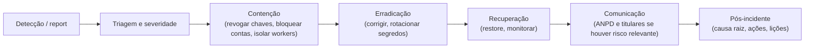

# Controles de Segurança

Mapeamento: cada controle cita as ameaças do `threat-model.md` (T-xx). Padrões de referência: **OWASP MASVS/MASTG** (app), **OWASP ASVS L2** e **API Security Top 10** (backend), **CIS** (infra).

## 1. App iOS

### 1.1 Armazenamento
| Controle | Detalhe | Ameaças |
|---|---|---|
| Tokens no Keychain | `kSecAttrAccessibleWhenUnlockedThisDeviceOnly`; sem iCloud Keychain; sem `UserDefaults`/arquivos | T-01 |
| Biometria opcional para ações sensíveis | `LAContext` + `SecAccessControl` (`.biometryCurrentSet`) ao exportar dados/excluir conta | T-01 |
| Cache de mídia | `NSFileProtectionComplete` (ou `CompleteUnlessOpen` para uploads em background); excluir do backup (`isExcludedFromBackup`) | T-26 |
| Sem segredos embutidos | Nenhuma chave de API privilegiada no binário; configuração por ambiente; apenas chaves públicas | T-19 |
| Logs | `os.Logger` com `privacy: .private`; nada de token, e-mail ou endereço; sem logs verbosos em release | T-26 |
| Tela sensível | Esconder conteúdo no app switcher (overlay) quando houver dados sensíveis | T-26 |
| Pasteboard | Não copiar tokens; links de compartilhamento só por ação explícita | T-26 |

### 1.2 Rede
| Controle | Detalhe | Ameaças |
|---|---|---|
| ATS estrito | Sem exceções (`NSAllowsArbitraryLoads = NO`); TLS 1.2+ (preferir 1.3) | T-05 |
| Pinning de chave pública (SPKI) | Dois pins (atual + backup) via `URLSessionDelegate`; rotação planejada; kill-switch por configuração assinada para não "tijolar" o app | T-05 |
| Sem `WKWebView` genérico com conteúdo remoto | O viewer web roda em `WKWebView` restrito: `allowedOrigins`, JS controlado, sem `file://` acessível, `isInspectable = false` em release | T-16 |
| Timeouts e limites | Timeout, tamanho máximo de resposta, retry com backoff e jitter | T-13 |

### 1.3 Autenticação e integridade do cliente
| Controle | Detalhe | Ameaças |
|---|---|---|
| Sign in with Apple com nonce | Nonce aleatório, hash SHA-256, validação no servidor | T-02 |
| Refresh rotativo | Armazena só o token mais recente; ao receber `session_revoked`, limpa Keychain | T-01 |
| **App Attest** (`DCAppAttestService`) | Atesta a chave do app no servidor; asserções assinadas nas rotas sensíveis (login, criar job, billing); fallback para risco alto em aparelhos sem suporte | T-04 |
| **DeviceCheck** | Bit de dispositivo para anti-abuso de trial/créditos | T-12, T-13 |
| Sinais de comprometimento | Heurísticas de jailbreak (arquivos conhecidos, `fork`, escrita fora do sandbox, dyld injetado) enviadas como **sinal de risco**, não como bloqueio absoluto | T-04 |
| Anti-debug básico | `ptrace(PT_DENY_ATTACH)` em release (dificulta, não impede); build sem símbolos de debug | T-04 |
| Ofuscação leve | Strip de símbolos, Swift symbol obfuscation opcional; nunca depender disso para segurança | T-04 |
| Verificação de pacote de template/modelo | Assinatura Ed25519 do pacote; chave pública embutida | T-27 |

### 1.4 Entrada e mídia
| Controle | Detalhe | Ameaças |
|---|---|---|
| `PHPicker` | Sem pedir acesso total à biblioteca | Privacidade |
| Validação local | Tipos (HEIC/JPEG/PNG), dimensões, tamanho, decodificação com limites; recusar arquivos suspeitos | T-07 |
| Remoção de EXIF/GPS | Re-encode via `CGImageDestination` sem metadados de localização antes de enviar | T-11 |
| Universal Links | `apple-app-site-association`; não usar esquema custom para ações sensíveis; validar parâmetros e exigir sessão | T-25 |
| Mensagens de erro | Genéricas ao usuário; detalhes só em logs seguros | T-14 |

### 1.5 Privacidade da plataforma
- `PrivacyInfo.xcprivacy` completo (APIs de motivos requeridos, tipos de dados coletados)
- Textos de permissão claros (`NSCameraUsageDescription`, `NSPhotoLibraryAddUsageDescription`, `NSMotionUsageDescription` para ARKit)
- ATT **não** utilizado (sem tracking entre apps); sem SDKs de publicidade
- Rótulos de privacidade da App Store coerentes com o que o app coleta

## 2. API / Backend (Laravel)

### 2.1 Autenticação e sessão
| Controle | Detalhe | Ameaças |
|---|---|---|
| Access token | JWT/Sanctum de 15 min, escopos mínimos | T-01 |
| Refresh token | Opaco, 256 bits, armazenado como hash, rotativo; reuso revoga a família | T-01 |
| Senhas | Argon2id; política mínima 10+ caracteres; checagem contra senhas vazadas (k-anonymity do HIBP) | T-03 |
| MFA | TOTP opcional; obrigatório para admin | T-03, T-20 |
| Rate limit / lockout | Por IP, conta e dispositivo; atraso progressivo; CAPTCHA/Attest em risco alto | T-03 |
| Verificação de e-mail | Link de uso único e curto prazo | T-03 |

### 2.2 Autorização
| Controle | Detalhe | Ameaças |
|---|---|---|
| Policies em **toda** rota | `authorize()` com checagem de `owner_id`; falha fechada | T-06 |
| Escopo por consulta | `->where('owner_id', auth()->id())` via global scope + testes | T-06 |
| UUIDs | Sem IDs sequenciais expostos | T-06 |
| Funções de admin | Guard separado, RBAC, MFA, rede restrita, auditoria | T-20 |
| Teste automatizado de BOLA | Suite que tenta acessar recursos de outro usuário em todos os endpoints | T-06 |

### 2.3 Validação e entrada
| Controle | Detalhe | Ameaças |
|---|---|---|
| FormRequest estrito | Tipos, tamanhos, enums; rejeitar campos desconhecidos | T-14 |
| JSON Schema do `payload` de jobs | Validação por tipo; limites | T-14 |
| SQL | Eloquent/queries parametrizadas; revisão de `DB::raw` | T-14 |
| Sem SSRF | O backend não busca URLs fornecidas pelo usuário; allowlist se necessário, bloqueio de IPs privados/metadata | T-15 |
| Mass assignment | `$fillable` explícito | T-14 |
| Idempotência | Header `Idempotency-Key` em POST de criação de job/pagamento | T-12, T-13 |

### 2.4 Proteção HTTP
- HTTPS-only, HSTS (preload), TLS 1.2+
- Cabeçalhos: `X-Content-Type-Options: nosniff`, `Referrer-Policy`, `Permissions-Policy`, `Cache-Control: no-store` em respostas autenticadas
- CORS restrito às origens do viewer/painel; sem `*` com credenciais
- Limite de tamanho de corpo; compressão com cuidado (BREACH)
- Versionamento (`/v1`) e depreciação controlada
- Proteção contra enumeração de usuário (mesma resposta e tempo)

### 2.5 Billing
| Controle | Detalhe | Ameaças |
|---|---|---|
| Validação JWS | Cadeia até a raiz Apple, `bundleId`, `environment`, expiração | T-12 |
| Vínculo com usuário | `appAccountToken` = UUID do usuário | T-12 |
| Webhook Notifications V2 | Assinatura verificada, idempotência por `notificationUUID`, fila | T-12 |
| Ledger imutável | Créditos só por lançamentos; débito de job atômico (transação + unique) | T-12, T-13 |
| Reembolso/revogação | Reverte entitlements e créditos | T-12 |

## 3. Storage e uploads

| Controle | Detalhe | Ameaças |
|---|---|---|
| Buckets privados | Block Public Access; acesso só por URL assinada ou CDN com token | T-09 |
| URL pré-assinada | PUT, expiração ≤ 10 min, `Content-Length`, `Content-Type` e `x-amz-checksum-sha256` fixados, chave aleatória (`uploads/{user}/{uuid}`) | T-09 |
| Quarentena | Objeto novo vai para prefixo `quarantine/`; só após validação é promovido | T-07 |
| Pipeline de sanitização | magic bytes, decodificação com limite de pixels (ex.: ≤ 50 MP) e de memória, re-encode, remoção de metadados, antivírus (ClamAV), hash | T-07, T-08 |
| Tipos permitidos | JPEG, HEIC, PNG (foto); MP4/MOV (saída); nenhum SVG/HTML/PDF de usuário | T-07, T-16 |
| Content-Disposition/Type | Servir com `Content-Type` correto e `nosniff`; domínio separado para mídia (sem cookies) | T-16 |
| Ciclo de vida | Expurgo de `pending` expirados, rejeitados, derivados antigos | T-23 |
| Criptografia | SSE-KMS; chaves separadas por ambiente | T-19 |

## 4. Workers e IA

| Controle | Detalhe | Ameaças |
|---|---|---|
| Sandbox | Containers não-root, `readOnlyRootFilesystem`, `seccomp`, `no-new-privileges`, limites de CPU/RAM/tempo, `tmpfs` para trabalho | T-08 |
| Sem egress | Rede de saída bloqueada; acesso apenas ao storage/DB via endpoints privados | T-08, T-15 |
| Credenciais mínimas | Papel de storage restrito aos prefixos do job; DB com `worker_rw` | T-06, T-08 |
| Entradas só sanitizadas | Modelos e FFmpeg recebem derivados já re-encodados | T-07, T-08 |
| Fuzzing | Fuzz do parser de `capture.json` e do template JSON em CI | T-08, T-14 |
| Atualização | Imagens base atualizadas semanalmente; FFmpeg/ImageMagick/libheif com patch de segurança | T-08 |
| Sem shell com entrada de usuário | Argumentos como lista, nunca `shell=True` | T-14 |
| Limites de custo | Orçamento por job e por dia; kill automático | T-13 |
| Moderação | Antes de qualquer link público | T-22 |

## 5. Web (viewer e painel)

- **CSP** estrita (`default-src 'self'`; `script-src` com nonce; `frame-ancestors` por allowlist), `Trusted Types`
- Sem `innerHTML`; legendas e títulos sempre como texto
- Cookies `Secure; HttpOnly; SameSite=Lax` (painel); CSRF token
- Subresource Integrity para scripts de terceiros (preferir nenhum)
- Domínio de mídia separado; `Cross-Origin-Resource-Policy`
- Viewer não executa código vindo do manifest: apenas dados validados por schema

## 6. Infra, CI/CD e cadeia de suprimentos

| Controle | Detalhe | Ameaças |
|---|---|---|
| IaC e revisão | Terraform com revisão obrigatória e `tfsec/checkov` | Geral |
| Segredos | Secrets Manager/Vault; rotação; OIDC no CI (sem chaves longas) | T-19 |
| SAST/SCA | CodeQL/Semgrep, `composer audit`, `pip-audit`, `npm audit`, Dependabot | T-18 |
| Secret scanning | `gitleaks` pre-commit e no CI | T-19 |
| SBOM e assinatura | CycloneDX; imagens assinadas (cosign); build reprodutível quando possível | T-18 |
| Dependências Swift | SPM com versões fixas (`Package.resolved` versionado), revisar novos pacotes; preferir APIs da Apple | T-18 |
| Branch protection | PR + review + CI verde; commits assinados | T-18 |
| WAF e DDoS | Regras gerenciadas, limites por rota, bot management | T-03, T-13 |
| Isolamento de rede | VPC privada, sem IP público em DB/Redis/workers; security groups mínimos | Geral |
| Pentest | Antes do lançamento público e a cada fase; escopo: app, API, upload, billing | Geral |
| Bug bounty / contato | `security.txt`, e-mail de segurança, política de divulgação | Geral |

## 7. Monitoramento e resposta a incidentes

### 7.1 Detecção
- Alertas: picos de 401/403/429, falhas de App Attest, reuso de refresh token, muitos jobs por usuário, gasto de GPU acima do orçamento, downloads em massa de share links, falhas de validação de upload
- Logs centralizados, imutáveis, com retenção definida e **sem PII**
- Canary tokens em bucket e banco de teste

### 7.2 Plano de resposta (resumo)

- Contatos e papéis definidos antes do lançamento; exercício de mesa semestral
- **LGPD:** comunicar a ANPD e os titulares em caso de incidente com risco ou dano relevante, em prazo razoável (a regulamentação da ANPD indica prazo de 3 dias úteis; confirmar com o jurídico a versão vigente)

## 8. Moderação e abuso de conteúdo

- Denúncia dentro do app; fila de moderação no painel admin
- Modelo automático (IA-06) + revisão humana em casos duvidosos
- Política de remoção, notificação ao usuário e canal de contestação
- Procedimento para conteúdo ilegal grave: preservar evidências, bloquear acesso, acionar canais legais apropriados (jurídico define o fluxo)

## 9. Segurança por fase

| Fase | Foco adicional |
|---|---|
| 1 | Auth, upload, billing, privacidade, sandbox de workers |
| 2 | Proteção de capturas (dados de interior), custo de GPU, viewer embutível (frame-ancestors), integridade de modelos |
| 3 | KYC, antifraude de anúncio, pagamentos (PCI via gateway, sem tocar em cartão), moderação em escala, mensagens |

## 10. Regras de ouro

1. Nunca confiar no cliente: tudo que importa é decidido no servidor.
2. Falhar fechado.
3. Menor privilégio em toda credencial.
4. Sem PII em logs.
5. Todo arquivo de usuário é hostil até provar o contrário.
