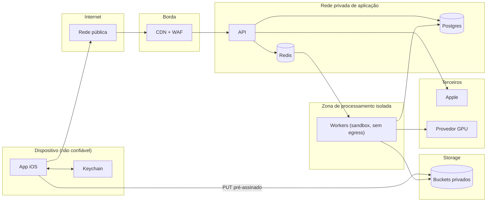

# Threat Model (STRIDE)

## 1. Ativos

| Ativo | Sensibilidade | Onde |
|---|---|---|
| Identidade e sessões (tokens, `apple_sub`, e-mail) | Alta | App (Keychain), banco |
| Endereço exato dos imóveis | Alta | Banco (cifrado) |
| Fotos, vídeos e tours | Média/Alta (podem conter pessoas, documentos, interior privado) | Storage |
| Dados de assinatura/créditos | Média | Banco |
| Chaves e segredos (KMS, APIs, assinatura) | Crítica | Gerenciador de segredos |
| Modelos de IA e templates | Média | Storage/app |
| Integridade do app (binário) | Alta | App Store/dispositivo |
| Disponibilidade e orçamento (GPU) | Alta | Infra |

## 2. Fronteiras de confiança e fluxo de dados

## 3. Análise STRIDE

| ID | Ameaça | Categoria | Componente | Impacto | Controles (ver `controles-de-seguranca.md`) |
|---|---|---|---|---|---|
| T-01 | Roubo de token no dispositivo | Information disclosure | App | Alto | Keychain `ThisDeviceOnly`, tokens curtos, rotação e detecção de reuso |
| T-02 | Replay/forja de token Apple | Spoofing | API | Alto | Validação de `iss/aud/exp/nonce` e JWKS |
| T-03 | Força bruta / credential stuffing | Spoofing | Login | Alto | Rate limit por IP/conta, Argon2id, bloqueio progressivo, MFA, verificação de senha vazada |
| T-04 | App modificado/clonado/automação | Tampering/Spoofing | App → API | Médio/Alto | App Attest, verificação de integridade no servidor, rate limit por dispositivo |
| T-05 | MITM em rede hostil | Tampering/Info disclosure | Rede | Alto | TLS 1.2+/ATS estrito, pinning de chave pública com backup, HSTS |
| T-06 | IDOR/BOLA (acessar imóvel de outro) | Elevation of privilege | API | Alto | Autorização por política em toda rota (owner check), IDs UUID, RLS opcional, testes automatizados |
| T-07 | Upload malicioso (polyglot, bomba de descompressão, SVG/HTML) | Tampering/DoS | Upload | Alto | Allowlist de tipos, magic bytes, re-encode, limites de pixel/tamanho, sandbox, antivírus |
| T-08 | Exploração de bibliotecas de imagem/vídeo (FFmpeg, ImageIO) | Elevation of privilege | Workers | Alto | Sandbox, usuário sem privilégio, seccomp, sem rede, atualizações, fuzz em CI |
| T-09 | URL pré-assinada vazada/reutilizada | Info disclosure | Storage | Médio | Expiração curta, limite de tamanho/tipo/checksum, chave única por upload, bucket privado |
| T-10 | Enumeração/adivinhação de share links | Info disclosure | Share | Médio | Token de 256 bits, armazenado como hash, expiração, revogação, rate limit |
| T-11 | Vazamento de localização (EXIF, endereço) | Info disclosure | Mídia/API | Alto | Remoção de EXIF no cliente e no servidor, endereço cifrado, `city_public` |
| T-12 | Fraude de assinatura/créditos (recibo falso, replay) | Tampering/Repudiation | Billing | Alto | Validação JWS server-side, `appAccountToken`, idempotência, ledger imutável |
| T-13 | Abuso de GPU/custos (DoS econômico) | DoS | Jobs | Alto | Cotas, créditos, limites de concorrência, teto de gasto, validação prévia de qualidade |
| T-14 | Injeção (SQL, comando, template) | Tampering | API/Workers | Alto | Queries parametrizadas, sem shell com entrada de usuário, validação de schema |
| T-15 | SSRF via URLs fornecidas (logo, mídia remota) | Info disclosure | API/Workers | Alto | Não buscar URLs de usuário; se necessário, allowlist, bloqueio de IP privado/metadata |
| T-16 | XSS no viewer/painel (títulos, legendas) | Tampering | Web | Médio | Escape/sanitização, CSP estrita, `Trusted Types`, sem `innerHTML` |
| T-17 | Clickjacking/embed malicioso do viewer | Tampering | Web | Baixo/Médio | `frame-ancestors` por allowlist de domínios do anfitrião |
| T-18 | Comprometimento de dependência (supply chain) | Tampering | Build | Alto | Lockfiles, SCA, SBOM, assinatura de artefatos, revisão de pacotes SPM/Composer/PyPI |
| T-19 | Vazamento de segredos no repositório/logs | Info disclosure | Dev/Ops | Alto | Gerenciador de segredos, scanning (gitleaks), redação de logs |
| T-20 | Escalada via painel admin | Elevation of privilege | Admin | Alto | SSO + MFA, RBAC mínimo, rede restrita, auditoria |
| T-21 | Ações sem rastreabilidade | Repudiation | Todos | Médio | `audit_log` append-only, correlação de IDs |
| T-22 | Conteúdo ilegal/abusivo (CSAM, nudez, golpes) | Abuso | Plataforma | Crítico | Moderação automática e manual, denúncia, retenção para investigação, procedimento legal |
| T-23 | Exclusão de conta mal executada (dados remanescentes) | Info disclosure | Dados | Médio | Pipeline `purge_user`, reconciliação de órfãos |
| T-24 | Engenharia social do suporte | Spoofing | Suporte | Alto | Procedimento de verificação, sem reset sem reauth, logs |
| T-25 | Deep link/Universal Link sequestrado | Spoofing | App | Médio | Universal Links (não esquemas custom), validar parâmetros, sem ações sensíveis via link |
| T-26 | Vazamento via backups, screenshots, clipboard, logs do app | Info disclosure | App | Médio | Excluir dados sensíveis do backup, ocultar em app switcher, sem logs sensíveis |
| T-27 | Modelos/templates adulterados no download | Tampering | App | Médio | Assinatura (Ed25519) e verificação do pacote |
| T-28 | Poisoning de dados de treino | Tampering | ML | Médio | Só treinar com dados curados e consentidos; revisão; versionamento |

## 4. Abuse cases adicionais (marketplace, Fase 3)

| Abuso | Controle |
|---|---|
| Anúncio falso/golpe de aluguel | Verificação do anunciante, revisão manual de primeiros anúncios, denúncia, detecção de fotos duplicadas (pHash) entre contas |
| Scraping de anúncios | Rate limit, bot detection, termos |
| Mensagens de spam/phishing | Limite de mensagens, filtros, bloqueio |
| Lavagem via pagamento | KYC por gateway, limites, monitoramento |

## 5. Riscos residuais aceitos (Fase 1)

- Dispositivo com jailbreak/root pode contornar controles locais: tratamos como sinal de risco (não como garantia) e protegemos o que importa no servidor
- Tours 3D públicos podem ser baixados por quem tem o link: aceito; mitigado por expiração/revogação e marca d'água opcional

## 6. Revisão

Revisar o threat model a cada nova fase, nova integração de terceiros ou incidente. Dono: AppSec. Frequência mínima: trimestral.
