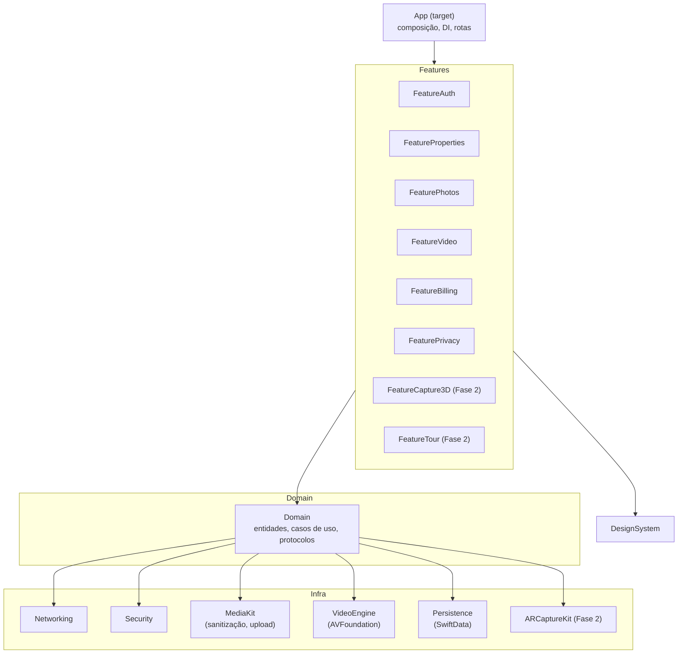

# Arquitetura do App iOS

## 1. Alvos e requisitos

| Item | Valor |
|---|---|
| Linguagem | Swift 6 (strict concurrency) |
| UI | SwiftUI (UIKit apenas onde necessário: câmera/AR, `UIViewRepresentable`) |
| Deployment target | iOS 17.0 (cobre o iPhone 15 de teste; reavaliar para 18 depois) |
| Dispositivos | iPhone (iPad opcional depois) |
| Dependências | Preferir APIs da Apple; SPM com versões fixas; poucas libs de terceiros |
| Bundle ID | `br.com.casareel.app` (placeholder) |
| Localização | pt-BR (padrão), en, es via String Catalog |

## 2. Camadas e módulos (SPM local)



Regras de dependência:
1. `Features` dependem de `Domain` e `DesignSystem`, nunca entre si (navegação via coordenadores/rotas do `App`).
2. `Domain` define protocolos; `Infra` implementa. Facilita testes e o port para Android (mesmos contratos).
3. `Security` não depende de nenhum módulo de feature.

## 3. Padrões

| Tema | Decisão |
|---|---|
| Arquitetura de UI | MVVM com `@Observable` (Observation) e estado imutável por tela |
| Navegação | `NavigationStack` + enum de rotas tipadas; Universal Links mapeados a rotas |
| Concorrência | `async/await`, `actor` para estado compartilhado (ex.: fila de upload), `@MainActor` em ViewModels |
| Injeção de dependência | Container simples por inicializador (sem libs); protocolos para trocar em testes |
| Persistência | SwiftData para rascunhos, fila de upload e cache de metadados; Keychain para segredos |
| Rede | `URLSession` com cliente tipado, interceptores (auth, attest, retry), decodificação `Codable` estrita |
| Erros | `enum AppError` com mapeamento do `Problem` da API e mensagens localizadas |
| Logs | `os.Logger` com categorias; `privacy: .private` por padrão |
| Feature flags | Config remota assinada (kill switch para recursos e pinning) |
| Telemetria | Eventos mínimos, sem PII, desligável (consentimento) |
| Acessibilidade | Dynamic Type, VoiceOver labels, contraste, reduzir movimento |

## 4. Estrutura de pastas

```
CasaReel/
├── CasaReel.xcodeproj
├── App/
│   ├── CasaReelApp.swift
│   ├── AppEnvironment.swift        # dependências e configuração
│   ├── Routing/
│   └── Resources/ (Assets, Localizable.xcstrings, PrivacyInfo.xcprivacy)
├── Packages/
│   ├── DesignSystem/
│   ├── Domain/
│   ├── Networking/
│   ├── Security/                   # Keychain, Attest, Pinning, IntegritySignals
│   ├── MediaKit/                   # validação, EXIF strip, hashing, upload
│   ├── VideoEngine/                # templates, composição, export
│   ├── Persistence/
│   ├── FeatureAuth/
│   ├── FeatureProperties/
│   ├── FeaturePhotos/
│   ├── FeatureVideo/
│   ├── FeatureBilling/
│   ├── FeaturePrivacy/
│   ├── ARCaptureKit/               # Fase 2
│   ├── FeatureCapture3D/           # Fase 2
│   └── FeatureTour/                # Fase 2
├── Tests/ (por pacote) + UITests/
├── Config/
│   ├── Debug.xcconfig / Staging.xcconfig / Release.xcconfig
│   └── (sem segredos; valores por ambiente)
└── fastlane/ ou ci_scripts/ (Xcode Cloud)
```

## 5. Motor de vídeo (VideoEngine)

### 5.1 Componentes
- `TemplateSpec` (Codable) = JSON do doc 04, validado e verificado por assinatura
- `SceneBuilder`: converte fotos + spec em `AVMutableComposition` com `AVVideoCompositionCoreAnimationTool` **ou** compositor customizado (`AVVideoCompositing`) com Core Image/Metal para Ken Burns e transições
- `MotionPlanner`: calcula o retângulo de origem/destino do pan/zoom usando saliency (Vision) e limites para evitar cortar rostos/objetos
- `AudioMixer`: trilha, fade, ducking
- `Exporter`: `AVAssetWriter` (controle fino de bitrate/codec) ou `AVAssetExportSession` (preset), com progresso e cancelamento
- `RenderQueue` (`actor`): um render por vez, política de memória e térmica (`ProcessInfo.thermalState`)

### 5.2 Boas práticas
- Reduzir fotos para o tamanho de render antes (evita estourar memória): decodificar com `CGImageSourceCreateThumbnailAtIndex`
- Reutilizar `CIContext` (Metal) e pools de buffer
- Pausar/cancelar em estado térmico `serious/critical` ou bateria baixa; mostrar aviso
- Salvar progresso (rascunho) para retomar se o app for encerrado
- Compatibilidade determinística com o worker: mesmas funções de easing e arredondamento definidas no spec

### 5.3 Formatos
| Saída | Resolução | Codec | FPS |
|---|---|---|---|
| Vertical | 1080×1920 | H.264 (HEVC opcional) | 30 |
| Horizontal | 1920×1080 | H.264 | 30 |
| Thumbnail | 1280×720 | JPEG | — |

## 6. Upload (MediaKit)

1. Seleciona com `PhotosPicker`/`PHPicker`
2. Carrega dados, valida tipo/dimensão/tamanho, **re-encoda sem EXIF/GPS** (`CGImageDestination` com propriedades limpas), calcula SHA-256
3. Solicita `upload-intents`
4. Envia com `URLSession` **background configuration** (retomável; arquivos temporários em `NSFileProtectionCompleteUnlessOpen`)
5. Confirma com `complete`; acompanha status; trata expiração da URL renovando a intent
6. Fila persistida (SwiftData) para sobreviver a reinício do app

## 7. Segurança no app (módulo `Security`)

| Componente | Responsabilidade |
|---|---|
| `KeychainStore` | CRUD tipado, `ThisDeviceOnly`, controle de acesso opcional com biometria |
| `TokenManager` (actor) | Mantém access/refresh, renova com lock (evita corrida), limpa em `session_revoked` |
| `AppAttestClient` | Gera chave, atesta, cria asserções para rotas sensíveis |
| `PinningDelegate` | Valida SPKI contra pins (atual + backup) |
| `IntegritySignals` | Coleta sinais de jailbreak/depurador e envia como risco |
| `SignedConfigVerifier` | Verifica assinatura de config remota/templates/modelos |
| `SecureLogger` | Wrapper com redação |
| `ScreenPrivacy` | Overlay no app switcher |

## 8. Fase 2 — Captura 3D (ARCaptureKit)

- `ARSession` com `ARWorldTrackingConfiguration` (funciona sem LiDAR); habilitar `sceneDepth` apenas se `supportsFrameSemantics(.sceneDepth)`
- Uma `CaptureSession` por cômodo; a cada ~0,25 s e se o deslocamento/rotação superar limiares, salvar: imagem (HEIC/JPEG), `camera.transform`, `camera.intrinsics`, `imageResolution`, `timestamp`, exposição
- **Guia em tempo real:** indicador de velocidade, mapa de cobertura angular, aviso de blur (variância do Laplaciano em baixa resolução), aviso de pouca luz (`lightEstimate`), contador de frames
- Gravar `capture.json` (schema versionado) com lista de frames e metadados
- Em dispositivos com LiDAR: salvar também `sceneDepth.depthMap` e confiança (opcional)
- Limites de memória/armazenamento: gravar em disco em streaming; abortar com aviso se espaço < 2 GB
- Upload em lotes com `URLSession` background

Viewer no app: `WKWebView` restrito carregando o viewer do domínio próprio (com `allowedOrigins`), ou visualizador nativo (RealityKit/Metal) em evolução futura.

## 9. Testes

| Tipo | Alvo | Ferramentas |
|---|---|---|
| Unitários | Domain, VideoEngine (planejamento de cenas), MediaKit, TokenManager | Swift Testing / XCTest |
| Snapshot | Telas e templates (frames-chave do vídeo) | swift-snapshot-testing (ou golden images) |
| Integração | Networking com servidor mock (URLProtocol), fluxo de upload | XCTest |
| UI | Login, criar imóvel, selecionar fotos, gerar vídeo, compra (StoreKit Testing) | XCUITest + `.storekit` config |
| Performance | Tempo de render, memória (Instruments), térmico | `XCTMetric` |
| Segurança | Pinning (falha com cert errado), Keychain, ausência de dados sensíveis em logs/backup | Testes dedicados + MobSF/objection |
| Acessibilidade | Auditoria | `performAccessibilityAudit()` |

## 10. Dívidas e decisões a revisitar
- Pinning versus rotação de certificados (processo e kill switch)
- HEVC vs H.264 no compartilhamento
- Visualizador 3D nativo vs web
- Suporte a iPad
