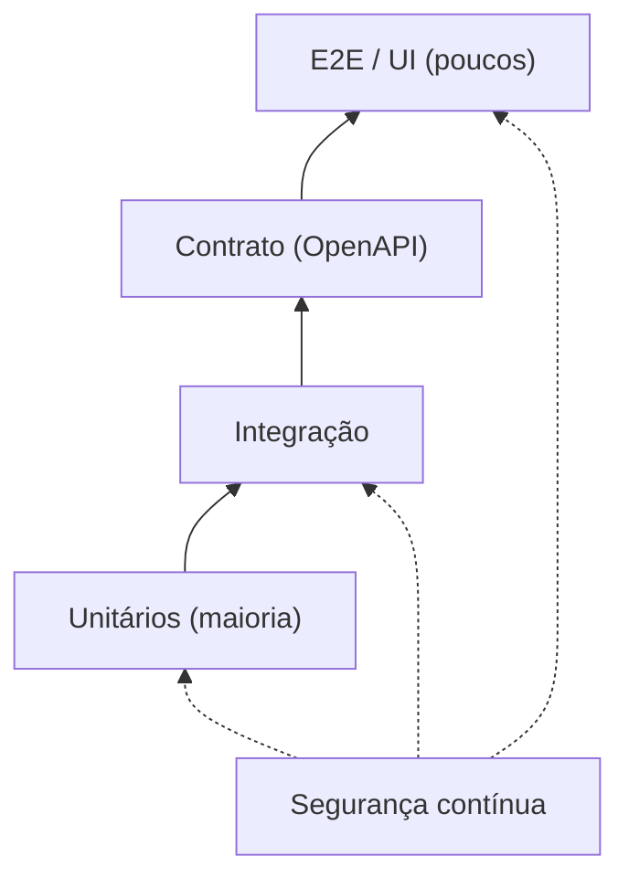
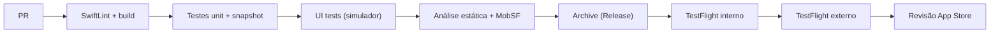

# Qualidade, CI/CD e Observabilidade

## 1. Estratégia de testes

| Camada | App iOS | Backend Laravel | Workers Python |
|---|---|---|---|
| Unitário | Swift Testing/XCTest | Pest | pytest |
| Integração | URLProtocol mock, SwiftData em memória | Pest + Postgres/Redis reais (Docker) | pytest + MinIO local |
| Contrato | Valida respostas contra `openapi.yaml` | `spectator`/Schemathesis contra a API | Teste do schema de job e template |
| E2E | XCUITest em simulador | Smoke em staging | Job completo em staging |
| Performance | `XCTMetric` (render, memória) | k6 nos endpoints críticos | Benchmark por tipo de job |
| Segurança | Pinning, Keychain, MobSF | BOLA suite, ZAP baseline, `composer audit` | `pip-audit`, fuzz de parsers, Trivy |

**Metas:** cobertura ≥ 70% no domínio; 100% dos endpoints com teste de autorização (dono × outro usuário × anônimo).

### Testes de segurança obrigatórios no CI
- BOLA/IDOR por endpoint (gerado a partir do OpenAPI)
- Upload: arquivo com extensão falsa, polyglot, imagem gigante (bomba de pixels), EXIF com GPS (deve sair limpo)
- Rate limit de login e criação de job
- Reuso de refresh token revoga a família
- Webhook Apple com assinatura inválida/duplicado
- Share link expirado/revogado retorna resposta idêntica a inexistente

## 2. Pipelines

### Backend e workers (GitHub Actions)

```mermaid
flowchart LR
    A["PR"] --> B["Lint + static analysis<br/>(Pint, PHPStan/Larastan, Ruff, mypy)"]
    B --> C["Testes unit + integração"]
    C --> D["SAST + SCA + secrets<br/>(CodeQL, composer/pip audit, gitleaks)"]
    D --> E["Build imagem + Trivy + SBOM + cosign"]
    E --> F["Deploy staging"]
    F --> G["Smoke + contrato + ZAP baseline"]
    G --> H["Aprovação manual"]
    H --> I["Deploy produção (canary / rolling)"]
    I --> J["Migrações expand → deploy → contract"]
```

### App iOS (Xcode Cloud ou fastlane + GitHub Actions macOS)

> Com 8 GB de RAM local, mantenha builds pesados e UI tests na nuvem (Xcode Cloud / runners macOS) e use a máquina local para desenvolvimento e depuração em aparelho.

## 3. Ambientes

| Ambiente | Uso | Dados |
|---|---|---|
| local | Docker Compose (Laravel, Postgres, Redis, MinIO, worker) | Sintéticos |
| staging | Espelho reduzido; App Store Sandbox | Sintéticos / anonimizados |
| produção | Usuários reais | Reais, com todos os controles |

Configuração por `xcconfig` no app (URLs, chaves públicas, pins); variáveis no backend via secrets manager.

## 4. Observabilidade

| Pilar | Ferramenta sugerida | Conteúdo |
|---|---|---|
| Logs | Loki/Datadog/CloudWatch | JSON estruturado, `request_id`, `user_id` opaco, **sem PII** |
| Métricas | Prometheus/Grafana ou Datadog | RED (taxa, erros, duração) por rota; fila (tamanho, idade); jobs (duração, falhas, custo) |
| Traces | OpenTelemetry | API → fila → worker → storage, propagando `trace_id` no payload do job |
| Erros | Sentry | App (com dSYM) e backend, scrubbing de PII |
| Crash/Performance iOS | Xcode Organizer + MetricKit | Crash-free, hangs, energia, térmico |
| Produto | Eventos mínimos (opt-in) | Funil: cadastro → fotos → vídeo → compartilhamento → assinatura |

### SLIs/SLOs iniciais
| SLI | SLO |
|---|---|
| Disponibilidade da API | 99,5% mensal |
| Latência p95 de leitura | < 300 ms |
| Tempo de fila p95 (CPU) | < 60 s |
| Taxa de sucesso de jobs | > 98% |
| Crash-free sessions (iOS) | > 99,5% |

### Alertas-chave
- Erros 5xx > 2% por 5 min
- Fila `default` com item > 10 min
- Job falhando > 5% em 15 min
- Gasto de GPU > 80% do orçamento diário
- Picos de 401/403/429 (ataque)
- Falha de backup / restauração
- Certificado TLS expirando em < 21 dias (também alerta para plano de rotação do pinning)

## 5. Controle de custos (FinOps)
- Tag por ambiente/feature/job-type
- Dashboard: custo por job, por usuário, por tipo; margem por plano
- Teto diário com *kill switch* de jobs GPU
- Revisão semanal de storage (ciclo de vida, derivados)

## 6. Release e versionamento
- SemVer para a API (`/v1`), build number automático no app
- Feature flags remotas para liberar gradualmente (e desligar rápido)
- Rollout faseado na App Store; critérios de rollback (crash-free < 99%, erro de login > 2%)
- Changelog e notas de versão em pt-BR

## 7. Definition of Done (por história)
- [ ] Critérios de aceite atendidos
- [ ] Testes unitários e de integração
- [ ] Autorização e validação de entrada cobertas
- [ ] Sem PII em logs
- [ ] Acessibilidade verificada
- [ ] Documentação/OpenAPI atualizados
- [ ] Revisão por pares aprovada, CI verde
- [ ] Métrica/alerta adicionados quando aplicável
