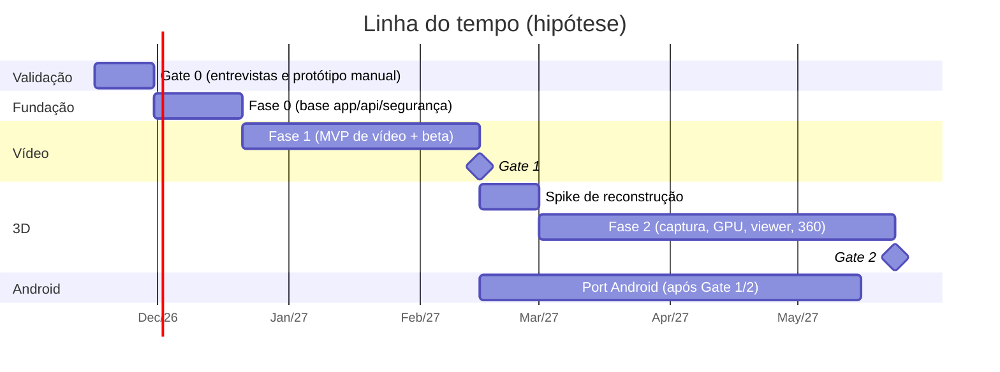

# Roadmap, Custos e Riscos

> Estimativas de esforço assumem 1 desenvolvedor full stack em tempo parcial com apoio de agentes de código; **são hipóteses** para planejamento, não compromissos. Ajuste após o Gate 0.

## Gate 0 — Validação (antes de codar) — 1–2 semanas
- [ ] 10–15 entrevistas com anfitriões/gestores: onde usariam o vídeo, quanto pagariam, que formato (9:16/16:9), frequência
- [ ] 5 vídeos feitos manualmente (CapCut/FFmpeg) com imóveis reais; medir reação e disposição a pagar
- [ ] Revisar termos das plataformas de hospedagem e regras de direitos de imagem
- [ ] Decisão go/no-go e posicionamento ("ferramenta de marketing do anfitrião")

**Critério de passagem:** ≥ 5 anfitriões dizem que pagariam e indicam o canal em que usariam.

## Fase 0 — Fundação (2–3 semanas)
| Entrega | Detalhe |
|---|---|
| Repositórios, CI, ambientes | Monorepo ou 3 repos (app, api, workers); Docker Compose local |
| Backend base | Auth, usuários, sessões, migrations do `schema.sql` |
| Storage e upload seguro | URL pré-assinada + pipeline de sanitização |
| App base | Projeto Xcode, módulos, design system, Keychain, rede, pinning, Sign in with Apple |
| Segurança base | Threat model aprovado, SAST/SCA/secrets no CI |

## Fase 1 — Vídeo (6–8 semanas)
| Sprint | Foco |
|---|---|
| 1–2 | Imóveis, seleção de fotos, upload, sanitização, análise (qualidade/ambiente/ordem) |
| 3–4 | VideoEngine: templates (3 iniciais), Ken Burns, transições, trilha, export 9:16/16:9 |
| 5 | Pré-visualização, edição de ordem/textos, marca d'água, compartilhamento e link público |
| 6 | StoreKit 2, entitlements, validação server-side |
| 7 | LGPD (exportar/excluir), moderação, acessibilidade, polimento |
| 8 | Hardening, pentest interno, TestFlight beta (20–50 anfitriões) |

**Gate 1 (métricas do beta):** ativação > 40%, ≥ 30% compartilham o vídeo, ≥ 3% pagam, crash-free > 99,5%.

## Fase 2 — Tour 3D (10–14 semanas)
| Etapa | Foco |
|---|---|
| Spike (2 sem) | Reconstruir 5 imóveis reais com captura ARKit no iPhone 15; medir qualidade/tempo/custo; decidir Gaussian Splatting vs alternativa |
| Captura (3–4 sem) | ARCaptureKit, guia em tempo real, upload em lotes |
| Reconstrução (3–4 sem) | Worker GPU, validação, limpeza, compressão, avaliação automática |
| Viewer web (2–3 sem) | Three.js, navegação, manifest, embed seguro (CSP/frame-ancestors) |
| Fallback 360 (2 sem) | Panoramas por cômodo + hotspots |
| Beta | 10–20 imóveis reais, ajuste de limiares |

**Gate 2:** ≥ 60% das capturas aceitas na 1ª tentativa, custo por tour ≤ 35% do preço, NPS dos anfitriões ≥ 40.

> **Risco central:** qualidade do 3D com iPhone sem LiDAR. O spike existe para decidir cedo; se falhar, o produto da Fase 2 vira **tour 360 guiado**, que é mais simples e robusto.

## Fase 3 — Marketplace (a definir; ≥ 4–6 meses)
Somente após tração das Fases 1 e 2: anúncios, busca (PostGIS), contato/reserva, pagamentos (gateway com KYC), moderação em escala, avaliações. Tratar como projeto próprio com PRD e threat model específicos.

## Android (após Gate 1 ou 2)
- Kotlin + Jetpack Compose; reutiliza OpenAPI, template JSON, viewer web
- Equivalentes: Play Integrity (no lugar de App Attest), Credential Manager, Play Billing, CameraX/MediaCodec (vídeo), ARCore (captura 3D)
- Estimar 60–70% do esforço do iOS por reaproveitamento de backend/contratos

## Custos (ordens de grandeza para planilha — validar com cotações reais)

### Fixos/mensais (início)
| Item | Observação |
|---|---|
| Apple Developer Program | US$ 99/ano |
| Domínio e DNS | Baixo |
| Hospedagem API + Postgres + Redis gerenciados | Plano inicial pequeno; escala com uso |
| Object storage + CDN | Cresce com GB armazenado e egress |
| Observabilidade (Sentry/logs) | Planos gratuitos/baixos no início |
| E-mail transacional | Baixo |
| Licença de músicas | Biblioteca royalty-free com licença comercial para redes sociais; **verificar termos** |
| Jurídico (termos, LGPD) | Pontual, importante |
| Pentest externo | Pontual antes do lançamento público |

### Variáveis
| Item | Driver |
|---|---|
| Render local | ~0 |
| Render servidor | minutos de vCPU |
| Parallax | segundos–minutos de GPU |
| Tour 3D | 10–30 min de GPU por tour (**medir no spike**) |
| Storage/egress | GB por imóvel × visualizações dos links |
| Comissão da loja | Percentual da Apple sobre assinaturas |

### Unit economics (modelo)
```
margem_por_tour = preço_tour
                  - custo_gpu - custo_storage_12m - custo_egress_estimado
                  - comissão_loja - impostos
```
Defina preço só após medir `custo_gpu` real no spike.

## Riscos e mitigação (consolidado)

| # | Risco | Prob. | Impacto | Mitigação | Dono |
|---|---|---|---|---|---|
| R1 | Falta de uso para o vídeo fora do anúncio | M | A | Gate 0, posicionamento marketing | Produto |
| R2 | Qualidade do 3D sem LiDAR | A | A | Spike, validação de captura, fallback 360 | Eng/DS |
| R3 | Custo de GPU | M | A | Créditos, teto, spot, medição | Eng |
| R4 | Mercado Android | A | M | Port planejado, fluxo web | Produto |
| R5 | Rejeição na App Store | M | M | Seguir guidelines (exclusão de conta, billing, UGC) | Eng |
| R6 | Vazamento de dados/endereço | B | A | Seção 05, pentest, cifragem | AppSec |
| R7 | Conteúdo abusivo | M | A | Moderação, denúncia, termos | Produto/AppSec |
| R8 | Licenças de música/modelos | M | M | Biblioteca licenciada, revisão de licença | Produto |
| R9 | Escopo grande para 1 pessoa | A | A | Fases, gates, agentes de código, adiar marketplace | Todos |
| R10 | Mac com 8 GB | M | B | Aparelho físico, CI na nuvem, desligar Previews | Eng |

## Marcos

