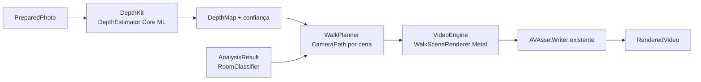
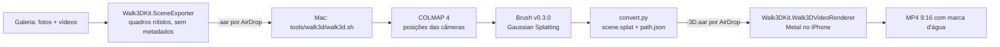

# CasaReel Walk — vídeo "andando pelo imóvel" a partir de fotos

> Status (2026-11-10): **Nível 1 implementado** (template `walk-tour`, grátis com marca d'água). **Walk 3D real implementado** (fotos + vídeos da galeria → Mac com COLMAP + Brush → vídeo no iPhone), ver seção 8. Nível 2 (IA generativa) descartado: custo e risco de anúncio enganoso.

## 1. A ideia

O anfitrião escolhe as fotos que já tem e recebe um vídeo em que a câmera **entra e anda pela casa**: avança pela sala, desvia do sofá, passa pela porta e chega no quarto. Nada de slideshow com zoom. É esse o diferencial frente a Canva/CapCut/InShot, que só fazem Ken Burns.

## 2. A verdade técnica (antes de prometer)

| Entrada | O que dá para gerar de forma confiável |
|---|---|
| 6–20 fotos de anúncio (sem sobreposição entre elas) | **2.5D**: dentro de cada foto a câmera se move com profundidade real (paralaxe), e uma transição "atravessando" liga um cômodo ao outro. Não dá para virar a câmera 180°, porque não existe o que está atrás do fotógrafo. |
| Fotos + IA generativa de vídeo | Movimento contínuo entre as fotos, mas o modelo **inventa** pixels (móveis, janelas). Isso é risco de anúncio enganoso. |
| Captura guiada com ARKit (Fase 2, P20) | **3D de verdade** (Gaussian Splatting): dá para andar livremente e renderizar qualquer trajeto de câmera. |

Conclusão: "andar pelo lugar" a partir de **fotos soltas** é 2.5D. O 3D livre exige a captura da Fase 2. O produto pode vender as duas coisas com o mesmo nome e níveis de qualidade diferentes.

## 3. Proposta em 3 níveis

### Nível 1: Walk 2.5D no aparelho (recomendado começar aqui)
- **Profundidade monocular** por foto com Core ML (candidato: Depth Anything V2 *Small*, licença Apache-2.0; as versões Base/Large são **não comerciais** e ficam proibidas). Alternativa a avaliar no spike: `ImagePresentationComponent.Spatial3DImage` do RealityKit (precisa confirmar se gera no iOS e se dá para renderizar offscreen).
- **Malha com profundidade**: a foto vira uma malha densa (grade ~256×192) deslocada pela profundidade. As bordas com salto grande de profundidade são "rasgadas" para não esticar pixels.
- **Câmera virtual** com movimentos limitados ao que a foto suporta: *dolly-in*, *truck* lateral, *crane* leve, órbita pequena. A amplitude é calculada pela profundidade e pela confiança, para não aparecer buraco.
- **Transição "atravessar"**: a câmera avança até o ponto de fuga/porta da foto A, e a foto B começa já em movimento, com blur de movimento + crossfade curto. Dá a sensação de continuidade.
- **Roteiro automático**: a ordem dos cômodos vem do `ShotOrderPlanner`/`RoomClassifier` que já existem (entrada → sala → cozinha → quartos → banheiro → área externa).
- **Render**: Metal/RealityKit offscreen → `CVPixelBuffer` → `AVAssetWriter` do `VideoEngine` existente (marca d'água, música, textos, pausa térmica, proxy de preview: tudo reaproveitado).
- **Fallback**: foto com espelho, vidro grande ou profundidade de baixa confiança cai para Ken Burns com um movimento mais sutil.
- Custo de servidor: **zero**. Privacidade: as fotos **não saem do aparelho**.

### Nível 2: Walk AI (servidor, opcional)
- Modelo image-to-video com controle de câmera que interpola foto A → foto B.
- Exige: upload (P08 já existe), GPU por vídeo, **aprovação explícita** de fornecedor (regra 7 do CLAUDE.md) e LGPD.
- Guardrails obrigatórios: gerar só as transições (as fotos reais aparecem intactas), selo "transição simulada" e checagem de política do Airbnb/Booking sobre representação fiel.
- Decidir só depois de validar o Nível 1 com usuários.

### Nível 3: Walk real a partir da captura 3D (Fase 2)
- O pipeline P20/B20 já gera `tour.splat`. Acrescentar um **renderizador de trajeto**: definir uma câmera de "caminhada" pelos cômodos e exportar MP4 (no servidor, junto do treino).
- Assim o mesmo produto ("vídeo andando") sai em duas qualidades: 2.5D (fotos) e 3D real (captura).

## 4. Arquitetura (Nível 1)

Novos tipos e módulos (seguindo `07-app-ios/arquitetura-ios.md`):
- **Domain**: `DepthEstimating` (protocolo), `DepthMap`, `CameraMove` (`.dollyIn`, `.truck`, `.crane`, `.orbit`, `.kenBurns`), `CameraPath`, `WalkTransition`. Em `VideoScene`, um campo opcional `cameraPath`.
- **DepthKit** (pacote novo): wrapper Core ML, cache da profundidade em disco ao lado da foto preparada (com a mesma proteção de arquivo) e métrica de confiança.
- **VideoEngine**: `WalkSceneRenderer` (malha + câmera) como um novo tipo de cena dentro do template JSON (`"kind": "walk"`). Os templates atuais continuam funcionando.
- **FeatureVideo**: template "Walk" no editor, prévia em proxy de 540p, controle de "intensidade do movimento" e respeito ao **Reduzir Movimento** (cai para Ken Burns).
- **Modelo**: distribuir via Background Assets/On-Demand Resources para não inflar o app (~50 MB em FP16).

## 5. Metas de desempenho (iPhone 15, A16)
- Profundidade: < 150 ms por foto (518 px, Neural Engine).
- Render: vídeo de 30 s / 30 fps (900 frames) em 1080p em < 60 s.
- Memória: < 400 MB de pico; uma malha e uma textura carregadas por vez.

## 6. Spike de validação (2 semanas)
1. Rodar Depth Anything V2 Small em 50 fotos reais de anúncio e medir tempo e qualidade visual.
2. Protótipo do `WalkSceneRenderer` com dolly-in + transição em 3 fotos.
3. Testar `Spatial3DImage` no iOS como alternativa.
4. Teste cego com 5 anfitriões: Walk vs Ken Burns. Critério para seguir: **≥ 4 de 5 preferem o Walk**.
5. Medir taxa de fallback (meta: < 25% das fotos).

## 7. Decisões (tomadas em 2026-11-09/10)
- [x] Modelo de profundidade: Depth Anything V2 Small (Core ML da Apple, Apache-2.0, 24 MB) empacotado no app.
- [x] Walk: **grátis com marca d'água** (Pro sem marca d'água).
- [x] Nível 2 (IA generativa): **descartado**. Tudo deve ser gratuito.
- [x] "Fase 2 do Walk": 3D real a partir das **fotos e vídeos da galeria** do anfitrião, processado **no Mac** com ferramentas gratuitas (sem servidor pago).

## 8. Walk 3D real (implementado)

- **Por que não usar os vídeos gerados pelo app como entrada:** o movimento deles é simulado (2.5D), e o 3D sairia com as distorções da simulação. A entrada são fotos e vídeos reais.
- **iPhone, exportação** (`Walk3DKit/Export`): até 40 fotos + 200 quadros. Os quadros são escolhidos pelo mais nítido de cada janela (variância do Laplaciano), e o descarte de repetidos (dHash) remove os momentos com a câmera parada. Tudo é regravado em JPEG só com os pixels (sem EXIF/GPS) e cada vídeo vira uma pasta, o que dá uma "câmera" para o COLMAP.
- **Mac** (`tools/walk3d`, ver README): extração de pontos SIFT na CPU, comparação exaustiva, `global_mapper` (ou `mapper`), escolha do maior modelo e remoção de distorção; depois o Brush com `--sh-degree 0` e o `convert.py` (biblioteca padrão do Python).
- **iPhone, vídeo** (`Walk3DKit/Splat`): o `.aar` é aberto extraindo **só** `scene.splat` e `path.json` (arquivos regulares; o resto é ignorado). Renderização clássica de 3DGS em Metal: covariância projetada (EWA), quads instanciados, ordenação de trás para frente por counting sort de 16 bits na CPU e blend pré-multiplicado. O caminho é o das câmeras dos vídeos, suavizado, com o horizonte nivelado (um único "para cima") e reamostrado com velocidade constante. Duração de 12–45 s, 1080×1920, 30 fps, pausa por calor.
- **Telas** (`FeatureWalk3D`): Criar → "Criar Walk 3D", em 3 passos (escolher mídia, montar no Mac, importar e gerar o vídeo).
- **Limitações conhecidas:** cores só com o termo DC (sem reflexos que mudam com o ângulo); o processamento no Mac leva de 30 min a 2 h; ainda não testado com uma casa real.

## 9. Walk 3D 100% no aparelho (em andamento, decidido em 2026-11-10)
O anfitrião não deve precisar mandar nada para o Mac: a captura e o treino rodam no iPhone, sem servidor.
- **Captura no app com ARKit** (sem LiDAR): o rastreamento de mundo já dá a pose de cada quadro, o que elimina o COLMAP. `Walk3DKit/Capture`: `ARSceneCapture` grava quadros-chave (a cada ~12 cm ou ~8°, no máximo 240, lado maior de 960 px, JPG sem metadados), `capture.json` (intrínsecos e pose câmera→mundo no padrão OpenCV) e `points.bin` (pontos de referência do ARKit, usados como ponto de partida do treino). **Feito (etapa 1).**
- **Treino dos Gaussian splats em Metal no aparelho** (etapa 2). **Feito.** `Walk3DKit/Training`: 3DGS clássico simplificado (cor sem dependência de ângulo, perda L1). GPU: projeção, rasterização por blocos 16×16 (ida e volta) e Adam em kernels de computação. CPU: ordenação por profundidade e distribuição por bloco (memória compartilhada), clonar/dividir/podar a cada 100 passos. Começa pelos pontos do ARKit (cor tirada dos quadros, tamanho pelos vizinhos), completa até 5 mil se houver poucos. Padrões: 5 000 passos, imagens de 640 px, até 300 mil Gaussians. Grava `scene.splat` e `path.json` (poses niveladas pela gravidade, porque o celular fica em pé) ao lado da captura. Gradientes conferidos por diferenças finitas. Simulador: ~80 ms por passo com 100 mil Gaussians (~7 min); **falta medir no iPhone 15**.
- **Fluxo único na tela** (etapa 3): capturar → treinar → vídeo, reaproveitando `SplatRenderer` e `Walk3DVideoRenderer`. O fluxo pelo Mac (seção 8) sai nessa etapa.
- Limitações: vídeos antigos da galeria não servem (não têm pose); não roda no simulador (ARKit precisa do aparelho); qualidade menor que a do Mac.
